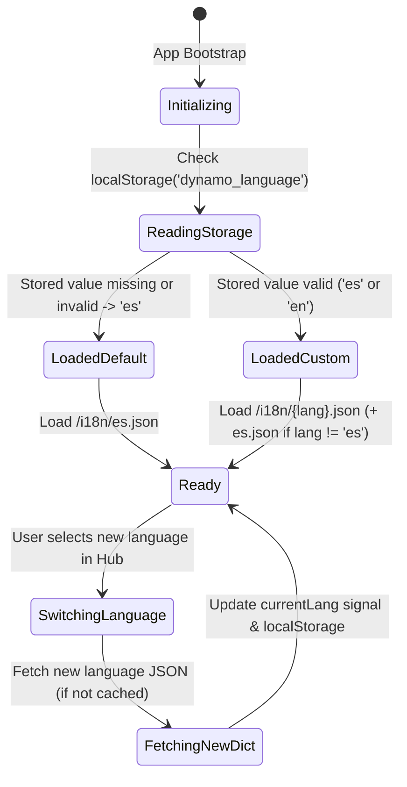

# Data Model: Internationalization & Translation System

**Feature**: `specs/004-i18n-translation-system`  
**Date**: 2026-10-18  

---

## 1. Entities & Types

### 1.1 `LanguageCode`
Supported language identifiers within the Dynamo platform.
```typescript
export type LanguageCode = 'es' | 'en';

export const DEFAULT_LANGUAGE: LanguageCode = 'es';
export const SUPPORTED_LANGUAGES: readonly LanguageCode[] = ['es', 'en'] as const;
```

### 1.2 `LanguageOption`
UI descriptor for language representation in the hub selector.
```typescript
export interface LanguageOption {
  code: LanguageCode;
  label: string;       // e.g. "Español", "English"
  flag: string;        // e.g. "🇪🇸", "🇺🇸"
  shortCode: string;   // "ES", "EN"
}
```

### 1.3 `TranslationDictionary`
In-memory dictionary mapping hierarchical dot-delimited translation keys to translated template strings.
```typescript
export type TranslationDictionary = Record<string, string>;
```
- Example:
  ```json
  {
    "common.cancel": "Cancelar",
    "hub.title": "Plataforma de Juegos Dynamo",
    "lobby.playerCount": "Jugadores conectados: {{count}}"
  }
  ```

### 1.4 `TranslationParams`
Interpolation parameters for dynamic value substitution in translation strings.
```typescript
export type TranslationParams = Record<string, string | number>;
```

### 1.5 `TranslationState`
Reactive state tracked in `TranslationService`.
```typescript
export interface TranslationState {
  currentLang: LanguageCode;
  translations: TranslationDictionary;
  fallbackTranslations: TranslationDictionary; // Always Spanish ('es')
  isLoading: boolean;
  hasLoaded: boolean;
}
```

### 1.6 `StoredLanguagePreference`
Schema for client-side persistence in browser `localStorage`.
- **Key**: `dynamo_language`
- **Value**: String (`"es"` or `"en"`)
- **Default**: `"es"`

---

## 2. Key Hierarchy & Organization

All translation keys use dot notation grouped by domain/feature:

```text
common.*
  ├── ok, cancel, save, edit, delete, back, close, error, loading
hub.*
  ├── title, subtitle, joinSession, createSession, sharedScreen
  └── games.* (localized catalog: biblicalRoulette.name, biblicalRoulette.description, etc.)
configure.*
  ├── title, gameLabel, roundsLabel, timerLabel, startButton, backButton
join.*
  ├── title, roomCodePlaceholder, playerNamePlaceholder, submitButton, invalidCode
lobby.*
  ├── title, roomCodeLabel, waitingText, startButton, editPlayer, deletePlayer
sharedScreenSetup.*
  ├── title, subtitle, addPlayer, playerNamePlaceholder, startMatch, minPlayersNotice
activeMatch.*
  ├── roundIndicator, exitPrompt, forfeitButton, scoresTitle, winnerAnnouncement
game.biblicalRoulette.*
  ├── spinButton, buyVowel, solvePhrase, phraseHintLabel, vowelStore.*, logModal.*, winModal.*
```

---

## 3. Validation Rules

1. **Language Code Validation**:
   - `code` must be one of `['es', 'en']`. Any unrecognized value retrieved from `localStorage` MUST default to `'es'`.
2. **Translation Key Integrity**:
   - Keys must not be empty or whitespace-only.
   - Keys should follow lowercase dot-notation `^[a-z0-9]+(\.[a-z0-9A-Z]+)*$`.
3. **Storage Fallback**:
   - If `localStorage.getItem` or `localStorage.setItem` throws (e.g. `SecurityError` in incognito or blocked cookies), the application MUST catch the error and keep the language state in memory without throwing.
4. **Resolution Fallback Rules**:
   - Step 1: Look up `key` in active language dictionary. If value is found and non-empty, proceed to interpolation.
   - Step 2: If not found in active language, look up `key` in Spanish dictionary. If found, proceed to interpolation.
   - Step 3: If not found in Spanish dictionary, return raw `key`.

---

## 4. State Transitions


