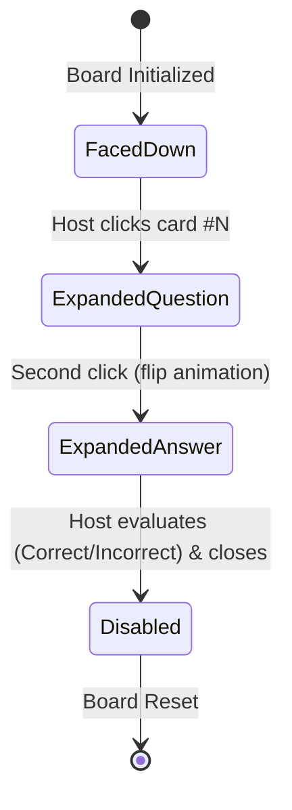

# Data Model: Card Question & Answer Game

**Feature**: `specs/005-card-qa-game`  
**Date**: 2026-10-18  

---

## 1. Domain Entities & TypeScript Types

### 1.1 `CardQuestionType`
Enum representing the three supported question categories:
```typescript
export type CardQuestionType = 'true-false' | 'option-selection' | 'open-question';
```

### 1.2 `CardQuestion`
Data model representing an individual question item:
```typescript
export interface CardQuestion {
  id: string;
  text: string;
  type: CardQuestionType;
  options?: string[]; // Candidate options for 'option-selection' (e.g. ["A) Nazaret", "B) Belén", "C) Jerusalén"])
  answer: string;     // Correct answer or reference proposed answer
  language: 'es' | 'en';
  source: 'database' | 'custom';
}
```

### 1.3 `CardState`
Lifecycle states for a board card tile:
```typescript
export type CardState = 'faced-down' | 'expanded-question' | 'expanded-answer' | 'disabled';
```

### 1.4 `BoardCard`
Represents an individual card displayed on the game grid:
```typescript
export interface BoardCard {
  index: number;         // 0-based array index
  number: number;        // 1-based display number (1..N)
  state: CardState;      // Current interaction state
  question: CardQuestion; // Assigned question
}
```

### 1.5 `QuestionResult`
Record of an evaluated question during gameplay:
```typescript
export interface QuestionResult {
  id: string;            // Unique UUID for evaluation entry
  playerName: string;    // Name of active player at evaluation time
  cardNumber: number;    // Number of the card opened (1..N)
  questionId: string;    // Id of question answered
  questionText: string;  // Prompt text (captured for reporting)
  questionType: CardQuestionType;
  answerText: string;    // Displayed answer
  isCorrect: boolean;    // Host evaluation (can be toggled in Results Modal)
  timestamp: number;     // Evaluation timestamp (Date.now())
}
```

### 1.6 `PlayerRound`
State tracking for the active player's current turn:
```typescript
export interface PlayerRound {
  playerName: string;
  questionQuota: number;       // Default 5 (configurable)
  currentCount: number;        // Questions answered so far in current round (0..quota)
  isCompleted: boolean;        // True when currentCount === questionQuota
}
```

### 1.7 `PlayerSummary`
Aggregated score summary for the Results Modal:
```typescript
export interface PlayerSummary {
  playerName: string;
  totalAnswered: number;
  correctCount: number;
  incorrectCount: number;
  scorePercentage: number;
  results: QuestionResult[];
}
```

### 1.8 `GameConfiguration`
Configurable match settings:
```typescript
export interface GameConfiguration {
  totalCardCount: number;       // Default 20 (e.g. 12, 16, 20, 24)
  questionsPerTurn: number;     // Default 5 (e.g. 3, 5, 10)
  questionSource: 'database' | 'custom';
  language: 'es' | 'en';
}
```

### 1.9 `CustomQuestionPackExport`
Schema for exporting/importing JSON question sets:
```typescript
export interface CustomQuestionPackExport {
  version: '1.0';
  exportedAt: string;          // ISO Date string
  title: string;               // Optional pack title
  language: 'es' | 'en';
  questions: Array<{
    id: string;
    text: string;
    type: CardQuestionType;
    options?: string[];
    answer: string;
    language: 'es' | 'en';
  }>;
}
```

---

## 2. Backend C# Domain Entities & DTOs

### 2.1 Entity: `CardQuestion` (`Dynamo.Core/Entities/CardQuestion.cs`)
```csharp
namespace Dynamo.Core.Entities;

public enum CardQuestionType
{
    TrueFalse = 1,
    OptionSelection = 2,
    OpenQuestion = 3
}

public class CardQuestion
{
    public Guid Id { get; set; } = Guid.NewGuid();
    public string Text { get; set; } = string.Empty;
    public CardQuestionType Type { get; set; }
    public string? OptionsJson { get; set; } // JSON serialized string array for option selection
    public string Answer { get; set; } = string.Empty;
    public string Language { get; set; } = "es";
    public DateTime CreatedAt { get; set; } = DateTime.UtcNow;
}
```

### 2.2 DTO: `CardQuestionDto` (`Dynamo.Application/Games/CardQa/Queries/CardQuestionDto.cs`)
```csharp
namespace Dynamo.Application.Games.CardQa.Queries;

public record CardQuestionDto(
    Guid Id,
    string Text,
    string Type,
    List<string>? Options,
    string Answer,
    string Language
);
```

---

## 3. Storage & State Persistence

| Data Target | Storage Mechanism | Schema / Key | Retention |
|:---|:---|:---|:---|
| **Platform Seeded Questions** | SQLite / PostgreSQL via EF Core | Table: `CardQuestions` | Permanent platform data |
| **Custom Questions** | Browser `localStorage` | Key: `dynamo_card_qa_custom_questions` | Persistent across browser sessions |
| **Portable Question Packs** | Downloadable `.json` file | Schema: `CustomQuestionPackExport` (v1.0) | File system / user storage |
| **Active Match State** | In-Memory Angular Signal Store | `CardQaService` signals | Ephemeral for session duration |

---

## 4. State Transitions

### 4.1 Card State Lifecycle


### 4.2 Card Rule Invariants
1. **No Unflip Invariant**: Once transitioned to `ExpandedQuestion`, a card cannot transition back to `FacedDown`. It MUST proceed to `ExpandedAnswer` and evaluation.
2. **Evaluation Invariant**: A card cannot transition from `ExpandedAnswer` to `Disabled` without host evaluation (`isCorrect` explicitly set).
3. **Disabled Immutability**: A `Disabled` card is completely unresponsive on the grid and cannot be re-opened during the current game.
4. **Correction Invariant**: In case of accidental host misclicks, the evaluation status (`isCorrect`) can be toggled inside the Results Modal, which triggers reactive score recalculation.
