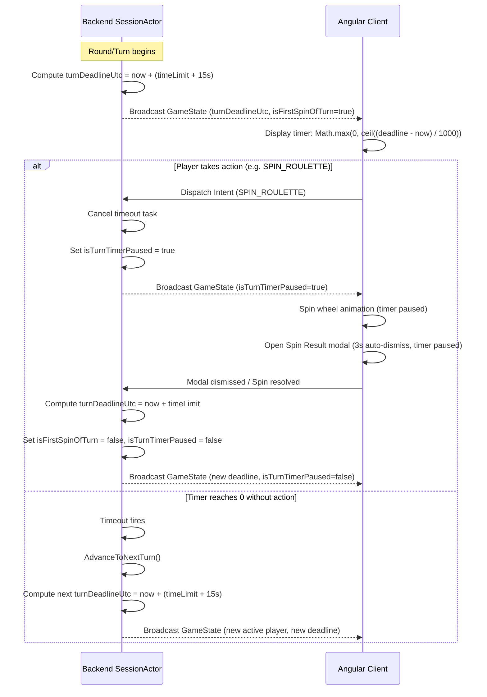

# Interface & Event Contract: Roulette Turn Timer & Polish

**Feature**: `specs/007-roulette-turn-timer`  
**Date**: 2026-10-24  

---

## 1. SignalR Game State Contract

The backend broadcasts the authoritative game state on the SignalR GameHub (`/hub/game` / `GameUpdate` event) whenever game actions occur.

### 1.1 State Payload Structure

```json
{
  "currentRoundIndex": 1,
  "totalRounds": 3,
  "maskedPhrase": "___ ___ __ ______",
  "currentTurnPlayerId": "player-guid-1",
  "currentTurnPlayerName": "David",
  "turnStep": "SelectConsonantOrBuy",
  "turnDeadlineUtc": "2026-10-24T05:30:45.123Z",
  "isTurnTimerPaused": false,
  "isFirstSpinOfTurn": true,
  "currentVowelCost": 150,
  "lastSpinResult": "500",
  "lastSpinValue": 500,
  "lastSpinAngle": 1827.0,
  "lastRevealedCount": 3,
  "lastPointsEarned": 1500,
  "hintRevealed": false
}
```

---

## 2. Player Intent Actions

Existing intent channels are utilized without introducing new action types:

### 2.1 `SPIN_ROULETTE`
- **Sender**: Active turn player
- **Payload**: `{ "letter": "D" }`
- **Effect**: 
  - Cancels active turn timer.
  - Generates spin result wedge.
  - Pauses timer during wheel spin and spin result modal.
  - If turn is retained, resets timer with standard configured limit (`timeLimitSeconds`).
  - Sets `isFirstSpinOfTurn = false`.

### 2.2 `PURCHASE_VOWEL`
- **Sender**: Active turn player
- **Payload**: `{ "letter": "A" }`
- **Effect**:
  - Validates vowel balance.
  - Deducts tier cost $\times$ occurrences.
  - Cancels active turn timer.
  - If turn is retained, resets timer with standard configured limit (`timeLimitSeconds`).
  - Sets `isFirstSpinOfTurn = false`.

### 2.3 `PURCHASE_HINT`
- **Sender**: Active turn player
- **Payload**: `null`
- **Validation**:
  - Requires `turnPlayer.Score >= 5000` (updated from 10,000).
  - Deducts exactly `5000` points.
  - Sets `hintRevealed = true`.
  - Resets turn timer with standard configured limit (`timeLimitSeconds`).

### 2.4 `SOLVE_PHRASE`
- **Sender**: Active turn player
- **Payload**: `{ "phrase": "DIOS ES AMOR" }`
- **Effect**:
  - If correct, awards round win, stops timer.
  - If incorrect, records `lastIncorrectGuess`, advances turn to next player, and starts fresh timer for next player.

---

## 3. Client Countdown Synchronization Protocol


